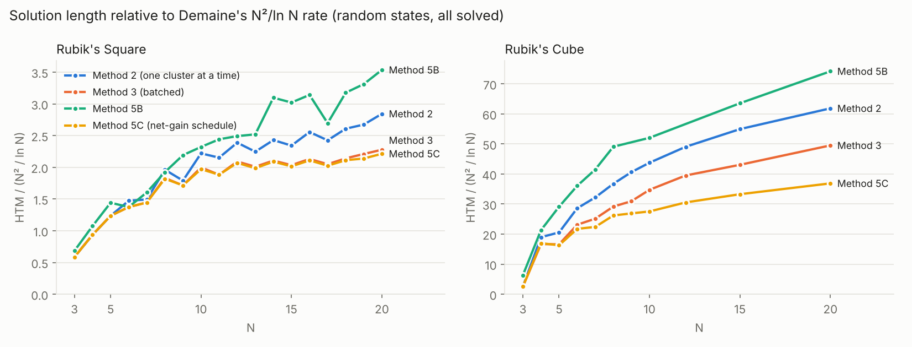
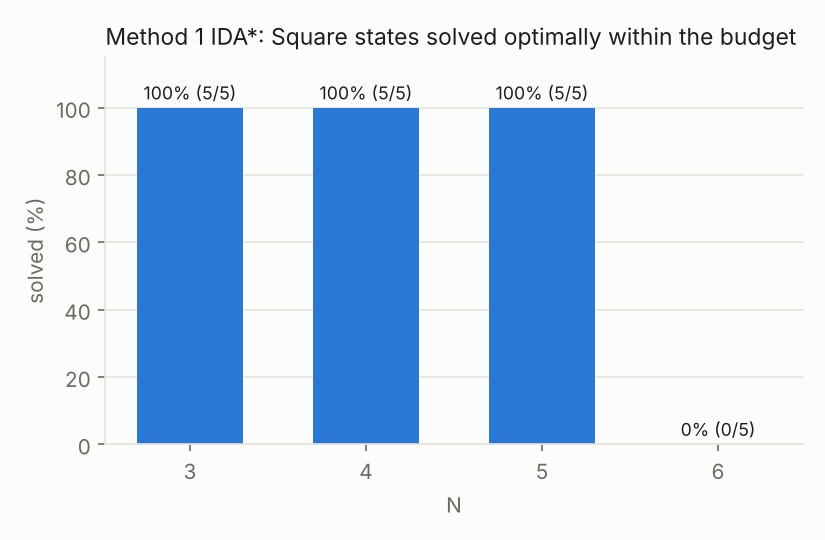

# Status (2026-10-31)

Summary: **all six methods are implemented, plus a new one, Method 5C** (net-gain scheduling
of bulk commutators), which is now the best method for the Cube at every N ≥ 5 and the best (tied with Method 3 at
N = 9, 11, 14) for the Square from N = 9 up. On the same random instances:
* **5C:** 4,925 HTM on the 20×20×20 against Method 3's 6,612 (−26%) and 5B's 9,904 (−50%); the
  gap to Method 3 grows with N (−6% at N = 6, −21% at N = 10, −23% at N = 15).
* **Square:** Method 1 gives exact optima up to N = 5 and Method 4's per-N models match them.
  For N = 9–20 (beyond the per-N models), 5C and Method 3 are shortest (5C ≤ Method 3 at every N),
  Method 2 next, all ahead of 5B. Exact God's numbers from full BFS: 6 (N = 3), 10 (N = 4), 12 (N = 5).
* **Cube:** Methods 2 and 3 solve 100% for N = 3–20; Method 3 is 20% shorter than Method 2 at
  N = 20 and 33% shorter than 5B. Method 1 solves 3×3×3 scrambles optimally (91/100 at
  depth 12 within 120 s each); random 3×3×3 states are beyond IDA* with Korf's databases on 4 CPU cores.
* HTM / (N²/ln N) still rises with N for every method, so none reaches Demaine's rate yet at N ≤ 20.

All numbers come from the harness or the evaluation scripts on CPU, no GPU (Methods 1–3: 4 cores).
Random states = long random canonical walks (Section 3.4). HTM after canonicalisation.
Instances are generated deterministically, so rows with the same N and id are the same states
across methods; the tables below average every method over the same instances.

## All methods, same instances

Rubik's Square, HTM (Square moves are all 180°, so QTM = HTM). n = instances per N.
Method 4 at W = 4096; 5A as in its section; "—" = not run at that N.

| N | n | M1 (optimal) | M2 | M3 | 5C | M4 | 5A | 5B |
|---|---|---|---|---|---|---|---|---|
| 3 | 5 | 4.2 | 4.8 | 4.8 | 4.8 | 4.2 | — | 5.6 |
| 4 | 5 | 6.4 | 10.8 | 10.8 | 10.8 | 6.4 | 6.4 | 12.4 |
| 5 | 5 | 8.8 | 19.2 | 19.2 | 19.2 | 8.8 | 9.8 | 22.4 |
| 6 | 5 | 0/5 in 120 s | 29.6 | 27.6 | 27.6 | 14.0 | 14.8 | 27.6 |
| 7 | 5 | — | 37.6 | 36.4 | 36.4 | 15.0 | 22.7 (3/5 solved) | 40.4 |
| 8 | 5 | — | 60.4 | 56.4 | 56.0 | 20.4 | 55.2 | 59.2 |
| 9 | 5 | — | 66.0 | 63.2 | 63.2 | — | — | 80.8 |
| 10 | 5 | — | 96.4 | 86.8 | 85.6 | — | — | 100.8 |
| 11 | 5 | — | 108.6 | 95.0 | 95.0 | — | — | 123.2 |
| 12 | 5 | — | 138.4 | 121.2 | 120.0 | — | — | 144.4 |
| 13 | 2 | — | 154.5 | 136.5 | 134.5 | — | — | 166.0 |
| 14 | 2 | — | 179.0 | 153.0 | 153.0 | — | — | 230.0 |
| 15 | 2 | — | 185.0 | 165.0 | 161.0 | — | — | 251.0 |
| 16 | 2 | — | 242.0 | 203.0 | 200.0 | — | — | 290.0 |
| 17 | 2 | — | 248.5 | 205.5 | 204.5 | — | — | 275.0 |
| 18 | 2 | — | 290.0 | 244.0 | 241.0 | — | — | 356.0 |
| 19 | 2 | — | 312.0 | 258.0 | 246.0 | — | — | 406.0 |
| 20 | 2 | — | 380.0 | 303.0 | 297.0 | — | — | 472.0 |

Methods 2, 3 and 5C were also run on 5 states for every N (`docs/results/m*_square_random.jsonl`):
at N = 20, 379.6 / 304.0 / 295.6 HTM.

Rubik's Cube, HTM (QTM in brackets), every state solved:

| N | n | M2 | M3 | 5C | 5B |
|---|---|---|---|---|---|
| 3 | 2 | 21.0 (31.0) | 21.0 (31.0) | 21.0 (31.0) | 52.0 (54.5) |
| 4 | 2 | 219.0 (259.5) | 192.5 (226.5) | 196.0 (224.5) | 246.0 (249.5) |
| 5 | 2 | 319.5 (359.0) | 258.0 (284.0) | **253.0** (281.0) | 452.5 (459.0) |
| 6 | 2 | 574.5 (654.5) | 464.5 (505.5) | **437.0** (481.5) | 724.5 (729.5) |
| 7 | 2 | 811.0 (911.5) | 633.0 (689.5) | **564.0** (614.5) | 1045.0 (1049.5) |
| 8 | 2 | 1131.0 (1255.0) | 897.5 (960.0) | **806.5** (863.0) | 1510.5 (1515.0) |
| 9 | 2 | 1498.0 (1648.5) | 1141.5 (1217.5) | **991.5** (1056.5) | — |
| 10 | 2 | 1900.5 (2113.5) | 1509.0 (1603.5) | **1196.5** (1256.5) | 2260.5 (2270.5) |
| 12 | 1 | 2843 (3123) | 2290 (2409) | **1770** (1861) | — |
| 15 | 1 | 4565 (4985) | 3578 (3767) | **2765** (2927) | 5280 (5292) |
| 20 | 1 | 8259 (8976) | 6612 (6898) | **4925** (5188) | 9904 (9916) |

## Method 5C: net-gain scheduling of bulk commutators — new
The novel method. Method 3 bulks one commutator type over a block of layers X × Y only when every
cell helps its cluster; once clusters diverge, blocks shrink to single cells (358 of Method 3's
385 center rounds on the 20×20×20 fixed a single orbit). 5C chooses each round's block by **net**
slots fixed per move, cells that do not help included when the block still pays, scores every
candidate exactly by applying it, discounts setup moves shared with the previous step, and (N ≤ 15)
looks one step ahead. Everything else is Method 3's, so the gain is the schedule alone.

| Cube N | M3 HTM | 5C HTM | change | 5C bulk rounds (centers) | 5C solve time |
|---|---|---|---|---|---|
| 6 | 464.5 | 437.0 | −6% | 22 of 22 | 4 s |
| 10 | 1509.0 | 1196.5 | −21% | 62 of 73 | 37 s |
| 15 | 3578 | 2765 | −23% | 142 of 184 | 223 s |
| 20 | 6612 | 4925 | −26% | 229 of 333 | 158 s (+132 s type bank) |

* The saving grows with N, and HTM / (N²/ln N) grows much more slowly (cube: 21.8 at N = 6 → 36.9 at
  N = 20, against Method 3's 23.1 → 49.5).
* Lookahead is worth ~2.5% (20×20×20: 4,794 with it, 4,925 without) for ~5× the time, so it is on
  only for N ≤ 15 by default (`lookahead=1` forces it).
* Square: the interior schedule is the shorter of 5C's net-gain schedule and Method 3's, so 5C is
  never longer than Method 3; it is shorter at most N ≥ 8 (e.g. 246 vs 258 at N = 19).
* N = 4 has one center orbit and one wing orbit, nothing to batch: 196.0 vs Method 3's 192.5.
* Not done yet (the planned learned part): a learned cost-to-go in place of the one-step lookahead,
  and choosing which identical center sticker goes where so orbits need the same next 3-cycle.

## Method 1: IDA* + pattern databases — implemented
* **Pattern databases** (Korf): corners 88,179,840 entries (max depth 11 HTM / 14 QTM), two 6-edge
  tables of 42,577,920 entries (max depth 10 HTM / 11 QTM), built by BFS in ~1 min per metric on 4 cores.
* **3×3×3, IDA\*** (parallel over the root's moves, ~12M nodes/s on 4 cores):
  * 100 scrambles of depth 12 (`docs/results/m1_cube3_d12.jsonl`, 120 s each): 91 solved optimally,
    mean 13.2 HTM (17.6 QTM), optimal lengths 8–16; the other 9 need more than 120 s.
  * Face-turn scrambles of depth 14 / 15 / 16: optimal in 3 s / 8 s / 905 s (10.2·10⁹ nodes).
    Each extra move costs ~13×, so a random state (~18 HTM) needs ~10¹²–10¹³ nodes: about a day per
    state here.
    Measured: 2 random states, 30 min each (`docs/results/m1_cube3_random.jsonl`): neither solved;
    each search covered ~2.7·10¹⁰ nodes and proved the optimum is longer than 16 HTM.
* **Square:** exact God's number from full BFS (colour goal, i.e. any of the 4 solved orientations):

  | N | states | God's number | distance distribution |
  |---|---|---|---|
  | 3 | 768 | 6 | 4, 24, 68, 160, 288, 156, 68 |
  | 4 | 82,944 | 10 | 4, 32, 152, 640, 2,464, 7,152, 16,248, 24,720, 20,700, 8,928, 1,904 |
  | 5 | 10,616,832 | 12 | 4, 40, 276, 1,648, 8,876, 42,752, 181,000, 641,772, 1,738,920, 3,105,096, 3,211,932, 1,446,544, 237,972 |

  (To the reference orientation only, the 3×3 Square's God's number is 8.)
* **Where exact search stops (Square):** IDA* with the max-cluster heuristic solves 100% of random
  states at N = 3, 4, 5 (N = 5 in 21 s on average) and 0% at N = 6 within 120 s.
  Optimal lengths are written into `data/square/N{3,4,5}/random.jsonl` (`optimal_len`).

  

## Methods 2 and 3: reduction vs Demaine's parallel algorithm — implemented
Both solve **100% of random states for N = 3–20 on both puzzles** (Square: 5 per N; cube: 2 per N
for N ≤ 10, 1 for 12, 15, 20). They share every non-batched stage, so the gap is the parallelism.

Moves per cube stage (mean HTM):

| N | wing parity | centers M2 | centers M3 | 3×3×3 (Kociemba) | wings M2 | wings M3 |
|---|---|---|---|---|---|---|
| 4 | 0 | 82 | 74 | 20 | 118 | 99 |
| 5 | 1 | 182 | 143 | 22 | 116 | 93 |
| 6 | 0.5 | 324 | 257 | 18 | 233 | 190 |
| 7 | 0.5 | 548 | 424 | 21 | 242 | 188 |
| 8 | 0.5 | 777 | 610 | 19 | 336 | 270 |
| 9 | 1.5 | 1109 | 844 | 21 | 368 | 277 |
| 10 | 1.5 | 1431 | 1141 | 20 | 449 | 347 |
| 12 | 3 | 2202 | 1799 | 19 | 621 | 469 |
| 15 | 4 | 3830 | 3035 | 21 | 710 | 518 |
| 20 | 4 | 7194 | 5885 | 19 | 1042 | 704 |

* Centers dominate. Method 3's batching works best early in the center stage (one round of the
  N = 20 cube applied one commutator type to 18.6 orbits on average) and fades as the orbits
  diverge, when single-orbit 3-cycles win the per-move score. Batching more of the late rounds is
  the obvious next step (a learned schedule is the Section 6.4 stretch goal).
* Every parity case is reached in the tests: odd wing orbits on odd and even N (Lemma 7 slice turn),
  and PLL parity on even N (one outer quarter turn before Kociemba).
* Speed: Method 2 solves a 20×20×20 in 92 s, Method 3 in 32 s (plus 92 s to build its type bank once per N).

## Method 5B: Rubik's Square, N = 3–20 — complete
`docs/results/m5b_square_random.jsonl` (width 128, widening to 2048; 900 s budget):

| N | n | solved | HTM mean ± 95% CI | HTM / (N²/ln N) | mean time (s) |
|---|---|---|---|---|---|
| 3 | 5 | 100% | 5.6 ± 1.9 | 0.68 | 0.0 |
| 4 | 5 | 100% | 12.4 ± 2.3 | 1.07 | 0.0 |
| 5 | 5 | 100% | 22.4 ± 4.0 | 1.44 | 1.2 |
| 6 | 5 | 100% | 27.6 ± 5.2 | 1.37 | 0.8 |
| 7 | 5 | 100% | 40.4 ± 5.7 | 1.60 | 1.3 |
| 8 | 5 | 100% | 59.2 ± 7.8 | 1.92 | 3.7 |
| 9 | 5 | 100% | 80.8 ± 9.7 | 2.19 | 5.3 |
| 10 | 5 | 100% | 100.8 ± 6.6 | 2.32 | 6.3 |
| 11 | 5 | 100% | 123.2 ± 13.6 | 2.44 | 9.3 |
| 12 | 5 | 100% | 144.4 ± 8.0 | 2.49 | 15.3 |
| 13 | 2 | 100% | 166.0 ± 15.7 | 2.52 | 24.8 |
| 14 | 2 | 100% | 230.0 ± 23.5 | 3.10 | 48.9 |
| 15 | 2 | 100% | 251.0 ± 21.6 | 3.02 | 53.3 |
| 16 | 2 | 100% | 290.0 ± 35.3 | 3.14 | 59.6 |
| 17 | 2 | 100% | 275.0 ± 2.0 | 2.70 | 65.1 |
| 18 | 2 | 100% | 356.0 ± 19.6 | 3.18 | 94.3 |
| 19 | 2 | 100% | 406.0 ± 31.4 | 3.31 | 120.1 |
| 20 | 2 | 100% | 472.0 ± 109.8 | 3.53 | 92.4 |

The normalised length still rises with N, so these solutions grow faster than N²/ln N: 5B
solves interior clusters a few at a time and does not yet batch them the way Demaine's
Lemma 4 does. That is the gap Method 3 (and a learned batching policy) should close.

## Method 5B: Cube, N = 3–20 — complete
`docs/results/m5b_cube_random*.jsonl` (2 random states per N for N ≤ 10, 1 for 15 and 20; width 512, widening per stage):

| N | n | solved | HTM mean ± 95% CI | QTM mean | HTM / (N²/ln N) | mean time (s) |
|---|---|---|---|---|---|---|
| 3 | 2 | 100% | 52.0 ± 15.7 | 54.5 | 6.35 | 19 |
| 4 | 2 | 100% | 246.0 ± 27.4 | 249.5 | 21.31 | 26 |
| 5 | 2 | 100% | 452.5 ± 2.9 | 459.0 | 29.13 | 62 |
| 6 | 2 | 100% | 724.5 ± 110.7 | 729.5 | 36.06 | 109 |
| 7 | 2 | 100% | 1045.0 ± 33.3 | 1049.5 | 41.50 | 161 |
| 8 | 2 | 100% | 1510.5 ± 120.5 | 1515.0 | 49.08 | 269 |
| 10 | 2 | 100% | 2260.5 ± 22.5 | 2270.5 | 52.05 | 530 |
| 15 | 1 | 100% | 5280 | 5292 | 63.2 | 1,875 |
| 20 | 1 | 100% | 9904 | 9916 | 74.2 | 4,760 |

What made the cube work (each step measured on the failing cases):
1. Edges-first stage order (corners → middle edges → wings → centers), split into 6-piece stages.
2. Coarse exact tables (opposite-colour pair; 3-class for corners, 153,090 states) combined with
   the cluster MLPs. Corners use the tables alone: 4–15× faster than max(MLP, tables).
3. Late center stages search only pure-center commutators [A, B C B'] (middle slice included),
   verified to move only centers: 5×5×5 centers went from budget-limited to < 5 s per stage.
4. Per-stage width ceiling scaled by action count (width × actions ≤ 1.2M).

**Solution length is the weak point.** These are several times longer than good NxN solvers:
the 3×3×3 optimum averages ~18 HTM; for scale, the KMCoders Kaggle Santa 2023 write-up
reports a 33×33×33 in 4,719 moves (their move metric may differ from our HTM), about half our
20×20×20 count. HTM / (N²/ln N) still rises with N, so
5B does not yet reach Demaine's growth rate on the cube. The stage
structure trades length for reliability: every 6-piece stage pays for commutators
(4–8 moves each) and keeps earlier work intact. The paper needs this to fall a lot.
Ranked by expected effect:
* min2phase for the final 3×3×3-equivalent part (corners + edges) instead of beam search.
* Larger pieces per stage once the cluster MLPs are trained properly on GPU
  (fewer, wider stages = less protection overhead), and wider beams via the host tier.
* Method 5A's per-token costs as the stage heuristic (5A beat 5B on the Square, below).
* Batching like Demaine Lemma 10: one commutator fixing many clusters at once.

## Method 5A: first signal
Model: d_model 64, 2 layers, 0.2M parameters, 2,500 steps on CPU, trained on Squares 4–8 only.
Distance-estimate correlation with true walk depth at the end of training:
N=6: 0.67, N=8: 0.64, **N=10: 0.66, N=14: 0.65, N=20: 0.53** (last three never seen).

Same instances as 5B (3 random states per N):

| N | 5A mode | 5A solved | 5A HTM | 5B HTM |
|---|---|---|---|---|
| 4 | full | 3/3 | 6.7 | 13.3 |
| 5 | full | 3/3 | 10.3 | 19.3 |
| 6 | full | 3/3 | 16.0 | 27.3 |
| 5 | staged | 3/3 | 16.0 | 19.3 |
| 8 | staged | 3/3 | 57.3 | 62.0 |
| 10 (unseen) | staged | 3/3 | 77.3 | 102.0 |
| 14 (unseen) | staged | 0/2 | timed out (300 s, CPU) | 230 |

Small samples, but in the direction the paper needs. Next: the go / no-go run on GPU
(`experiments/go_no_go_5a.sh`, 20k steps, d_model 192) and the cube model.

## Method 4 (CayleyPy reproduction): implemented; Square done, cube needs GPU training
Per-N ResMLP + beam search, as in Chervov et al. (Section 7). Committed CPU models
`checkpoints/m4/square{3..8}.pt` ("small" preset, 0.25–0.45M parameters, 4M examples for N ≤ 5 and
10M for N = 6–8, 1–4 min each on CPU; time and fit are recorded in each `.json`).

Squares, 5 random states per N, the same instances for every method (HTM; Square moves are all flips, so QTM = HTM):

| N | M4 W=16 | M4 W=64 | M4 W=256 | M4 W=1024 | M4 W=4096 | 5A | 5B |
|---|---|---|---|---|---|---|---|
| 3 | 4.2 | 4.2 | 4.2 | 4.2 | 4.2 | — | 5.6 |
| 4 | 6.8 | 6.4 | 6.4 | 6.4 | 6.4 | 6.4 | 12.4 |
| 5 | 9.8 | 9.8 | 9.4 | 9.0 | 8.8 | 9.8 | 22.0 |
| 6 | 16.0 (4/5) | 14.8 | 14.0 | 14.0 | 14.0 | 14.8 | 30.4 |
| 7 | 17.6 | 16.0 | 15.8 | 15.4 | 15.0 | 22.7 (3/5) | 40.8 |
| 8 | 27.3 (3/5) | 44.7 (3/5) | 24.5 (4/5) | 22.0 | 20.4 | 55.2 | 63.2 |

All 100% solved unless marked. W = 4096 takes ≤ 10 s per state on CPU. Length falls with log W, as the
paper reports, and the per-N model sets a hard bar for 5A: 5A roughly matches it on N ≤ 6 but is 2.7× longer at N = 8.

**3×3×3: not reproduced yet.** The paper3 model (4.0M parameters, 10 layers, QTM moves, kmax 26) trained
for 32M examples on CPU (77 min). That is 250× less data than the paper's 8B, and the fit is weak
(correlation with walk depth 0.90). With it, beam search solves short scrambles (depth 6/10/14 QTM: all
solved, at or below scramble length; depth 18: solved in 24–28) but **0 of 10 random states** at W = 256,
1024 or 4096, and 0 of 4 at W = 16384 (900 s each). The weights are `cube3.large.pt` (16 MB, git-ignored).
The 21.14 QTM check needs the GPU run: `DEVICE=cuda bash experiments/m4_cayleypy.sh`
(8192 epochs × 1M, then W up to 2¹⁸; `--kw '{"tier": "host"}'` for wider).

## External baselines: Kaggle Santa 2023 (KMCoders) and dwalton76
`rubiks/bench/santa2023.py` loads the competition's standard-goal cube puzzles (187 instances, N = 2..10, 19, 33;
downloaded, not committed) with a sticker / move mapping derived from the move permutations; KMCoders' published
final submission replays to the exact goal on all of them. Santa counts every slice quarter turn: our QTM.
All methods below solve to Santa's exact goal (`exact_orientation=True`). Mean QTM (`docs/results/santa/`):

| N | n | KMCoders (published) | dwalton76 | Method 6 | 5C | 3 | 2 |
|---|---|---|---|---|---|---|---|
| 2 | 20 | 10.2 | - | 10.2 | 29.4 | 29.4 | 29.4 |
| 3 | 82 | 22.2 | - | 32.0 | 32.0 | 32.0 | 32.0 |
| 4 | 43 | 66.7 | 88.6 | 109.4 | 217.5 | 229.3 | 266.9 |
| 5 | 19 | 97.1 | 160.2 | 159.3 | 282.5 | 296.3 | 361.1 |
| 6 | 6 | 161.0 | 324.0 | 276.0 | 503.0 | 534.7 | 696.3 |
| 7 | 4 | 208.8 | 539.0 | 356.2 | 593.8 | 680.8 | 880.2 |
| 8 | 3 | 291.3 | - | 468.7 | 856.0 | 993.3 | 1297.3 |
| 9 | 3 | 354.7 | - | 572.7 | 1020.0 | 1188.0 | 1594.0 |
| 10 | 4 | 461.5 | - | 743.0 | 1314.5 | 1597.0 | 2107.5 |
| 19 | 3 | 1620.0 | - | 2484.7 | 4710.7 | 6300.7 | 8188.7 |
| 33 | 1 | 4719 | - | - | - | - | - |

* **Method 6** is our implementation of the KMCoders method (optimal QTM corners, wing parity, annealing over
  inner-slice moves inserted anywhere, 4-move commutators and 3-cycles inserted at their cheapest time). It is
  1.5-1.7x KMCoders' lengths for N >= 4 (1.53x at N = 19) and the best non-KMCoders method from N = 6 up.
  Not yet reproduced from KMCoders: an optimal 3x3x3 for odd N, 6-move commutators, exact minimum-3-rot counts,
  beam search over 3-rot insertions and their compute budget (Rust, long runs).
* **dwalton76** (rubiks-cube-NxNxN-solver, run as a subprocess; its wide turns expanded to slice turns) is better
  than Method 6 at N = 4, equal at 5 and worse from 6 (its lookup tables, ~8 GB for N <= 7, limited us to N <= 7).
* Nobody here beats KMCoders yet.

## 20 states per size, 95% confidence intervals (`docs/results/stats/`)
Methods 2, 3 and 5C on 20 random states per size (cubes N = 3-10, Squares N = 3-20); every state solved. Paired
5C - Method 3 difference per state (mean +- 95% CI): cube N = 4: -2.8 +- 3.4 (not significant), 5: -9.7 +- 4.8,
6: -36.1 +- 8.7, 7: -60.6 +- 10.6, 8: -106.9 +- 13.1, 9: -188.2 +- 17.3, 10: -255.6 +- 18.6 (-17.2%). Square: 0 for
N <= 5, small but significant from N = 12 (-1% to -4%).

## Novelty check: God's numbers of the Rubik's Square
The 3x3x1 (the "Floppy Cube") agrees with published values: 192 positions up to whole-puzzle rotation (our 768 / 4),
God's number 6 with any orientation allowed and 8 with the exact orientation, matching the two published figures.
For the 4x4x1 (82,944 states, God's number 10) and 5x5x1 (10,616,832 states, 12) we found no published value
(web search, Oct 2026): they appear to be new, to our knowledge.

## Method 5B with GPU-trained cluster models (Colab T4, Shaurya)
Retrained cluster MLPs (width 512, 20k steps) are better walk-depth predictors but worse beam-search
heuristics: on the same CPU, code and instances, solutions were longer at N = 3, 4, 6 (shorter at N = 5)
and 3-20x slower; on the Colab run 2 of 14 cube states failed in wing stages. Kept as an option in
`checkpoints/m5b_gpu/` (README there); the CPU models stay the default.

## Known limitations
* Random states come from long random walks, not an exact uniform sampler.
* The checker enforces necessary conditions (property-tested); wing and center rules are
  per-layer multiset checks rather than full parity proofs.
* All timings are CPU-only and include contention with concurrent jobs.
* Method 1's pattern databases are the spec's 6-edge tables; 7-edge tables or inverse-state
  lookups would cut 3×3×3 search several-fold but not to random states on this CPU.
* Not run: the dwalton76 NxNxN solver (external baseline, needs network access to install).
